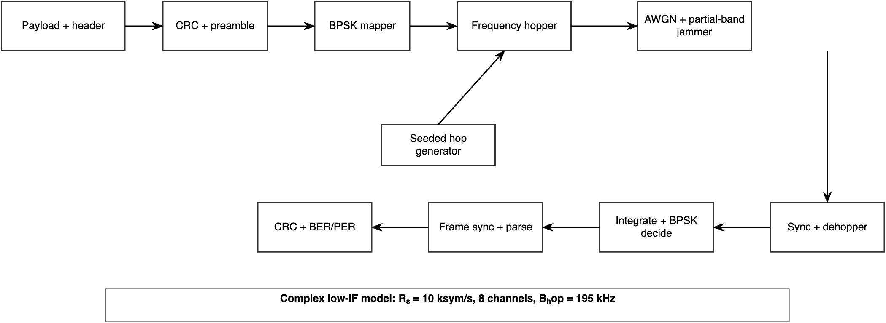
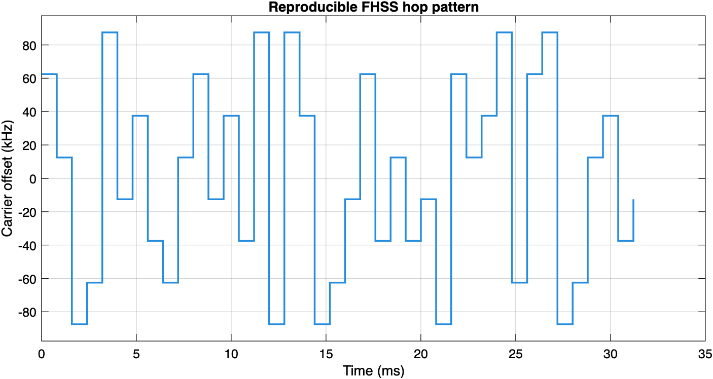
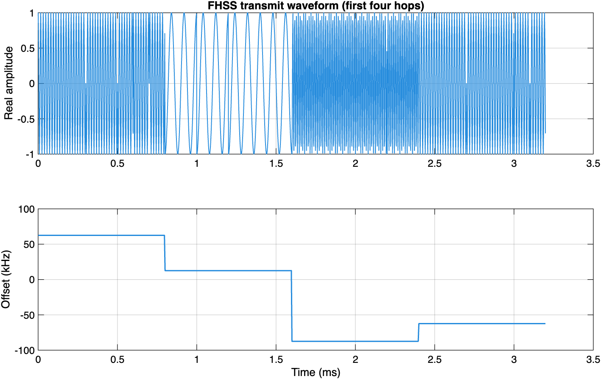
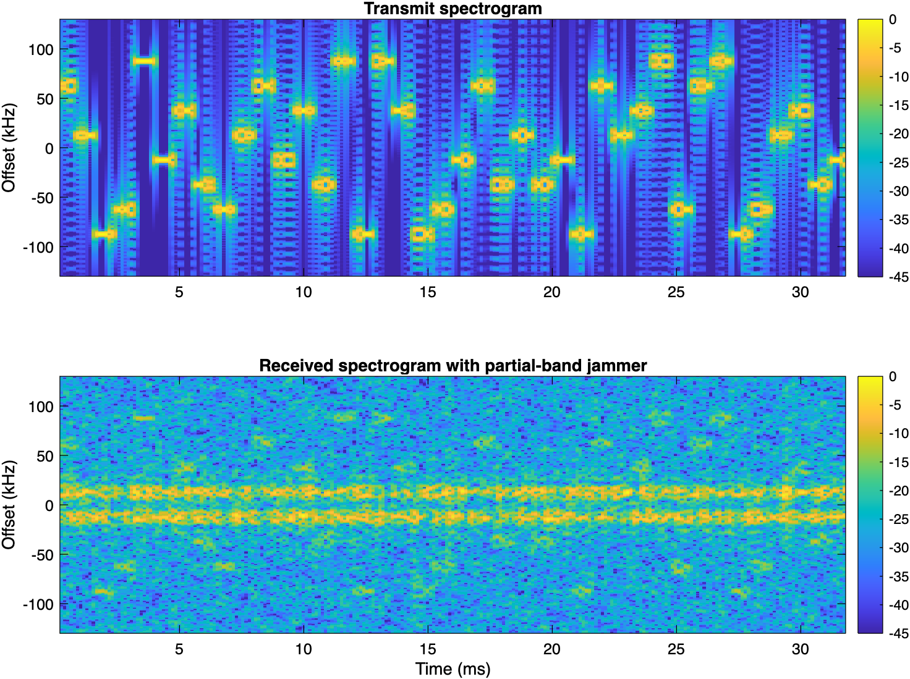
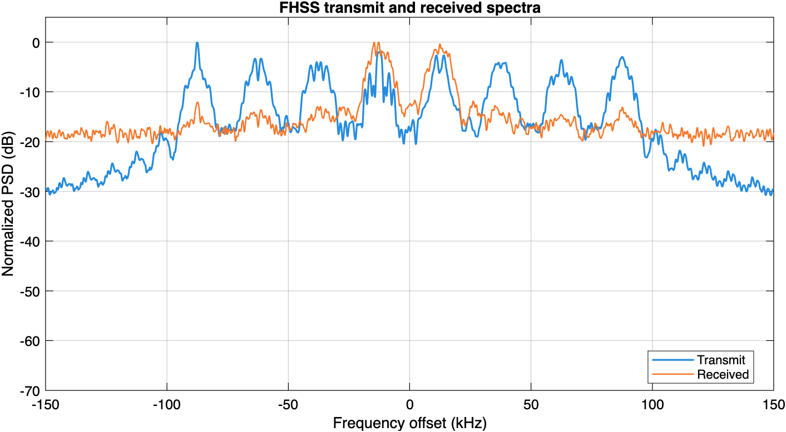
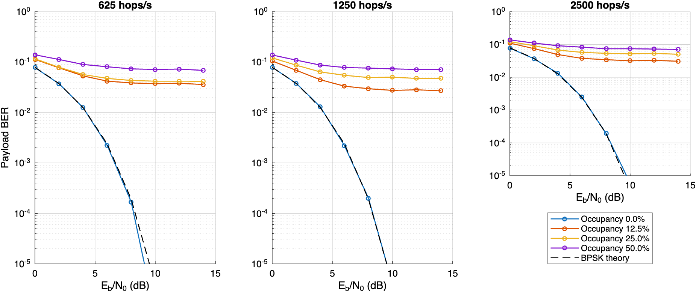
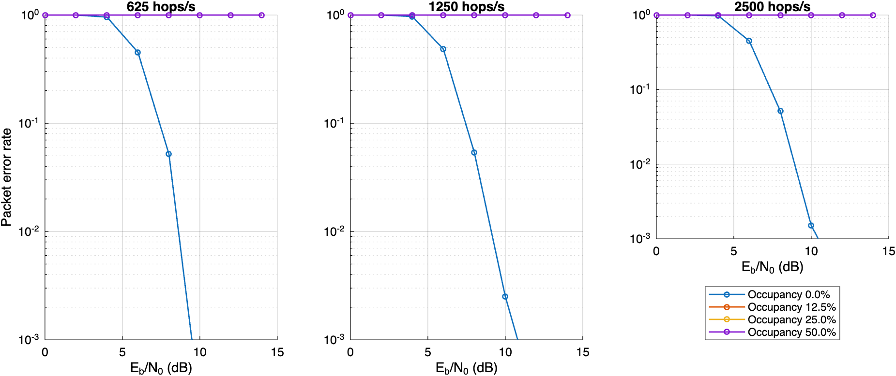
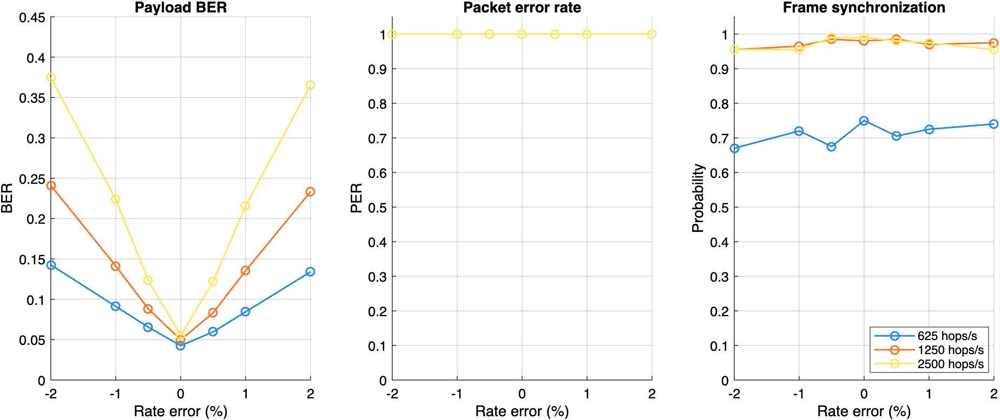
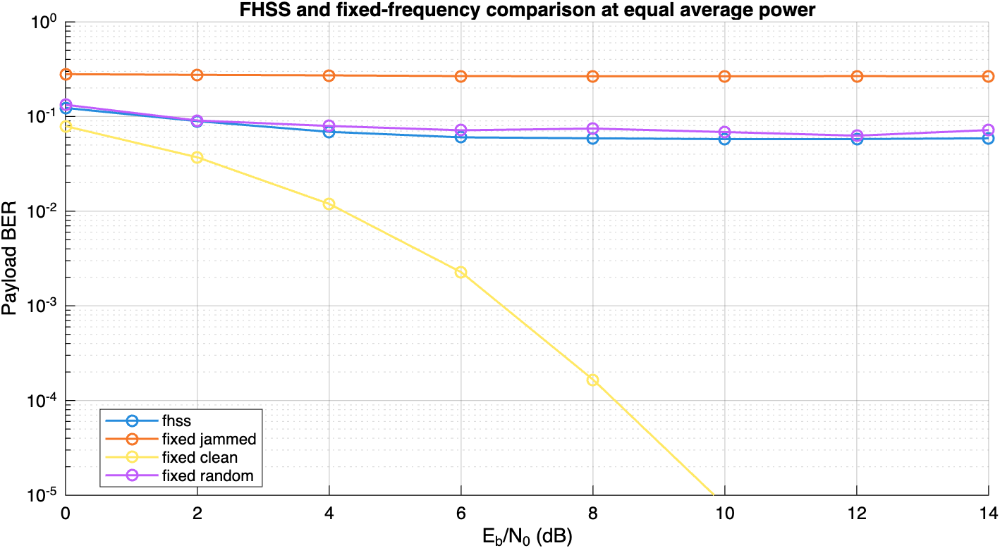

# Abstract

This project designs and evaluates a frequency-hopping spread-spectrum (FHSS) transceiver in base MATLAB. A framed BPSK payload is transmitted over eight pseudo-random carrier offsets while a jammer occupies only part of the hopping band. The receiver performs preamble-assisted hop timing and hopping-code acquisition, dehopping, coherent BPSK detection, frame synchronization, and CRC-16 checking. Reliability is measured using payload bit error rate (BER), packet error rate (PER), and synchronization probability. Experiments vary jammer occupancy, hop rate, hopping mismatch, and receiver dwell-rate error, then compare FHSS with an equal-power fixed-frequency BPSK link. The complete experiment is deterministic and requires no MATLAB toolboxes.

# Objectives

The work addresses four objectives:

1. Synthesize and visualize a reproducible framed FHSS waveform.
2. Model AWGN and a configurable partial-band interferer.
3. recover the payload through hop and frame synchronization, dehopping, BPSK demodulation, and CRC validation.
4. Quantify BER/PER and make an engineering recommendation for hop-set size and hop rate.

The implementation is a complex low-intermediate-frequency equivalent of a nominal 2.4 GHz radio. Directly sampling a 2.4 GHz carrier is unnecessary because frequency translation preserves the modulation and interference relationships being studied.

# System Design

## Transmitter and receiver architecture

{width=96%}

The transmitter appends a fixed synchronization word and CRC to each payload, maps the bits to BPSK symbols, and mixes each dwell interval to a carrier selected by a shared pseudo-random generator. The receiver evaluates timing and hopping-code candidates with the known preamble, reconstructs the winning carrier schedule, dehops the samples, and uses integrate-and-dump symbol decisions. A frame is accepted only if preamble detection and CRC validation succeed.

## Frame and modulation

The fixed-length 320-bit frame is shown in Table 1. The CRC covers the header and payload but not the preamble.

| Field | Length | Purpose |
|:--|--:|:--|
| Synchronization word | 32 bits | Hexadecimal `0x1ACFFC1D` |
| Frame counter | 16 bits | Packet identification |
| Payload | 256 bits | BER measurement data |
| CRC-16 | 16 bits | Packet acceptance |

: Frame format {#tbl:frame}

CRC-16/CCITT-FALSE uses polynomial $0x1021$, initial state $0xFFFF$, no input/output reflection, and no final XOR. Its standard `123456789` check value is $0x29B1$.

BPSK mapping is

$$
a_k = 1-2b_k,
$$

where $b_k\in\{0,1\}$ and $a_k\in\{+1,-1\}$. Rectangular pulse shaping gives 50 samples/symbol at $R_s=10$ ksymbol/s and $F_s=500$ ksample/s. Transmit power is normalized to unity.

## Hopping design and bandwidth

The eight low-IF carrier offsets are

$$
[-87.5,-62.5,-37.5,-12.5,12.5,37.5,62.5,87.5]\ \text{kHz}.
$$

They are separated by $\Delta f=25$ kHz. Rectangular BPSK has an approximate null-to-null occupied width $B_\text{ch}=2R_s=20$ kHz, leaving a 5 kHz separation margin. The total hopping bandwidth is

$$
B_\text{hop}=(N-1)\Delta f+B_\text{ch}
            =(8-1)(25)+20=195\ \text{kHz}.
$$

For $N_s$ symbols per hop,

$$
T_d=\frac{N_s}{R_s}, \qquad R_h=\frac{1}{T_d}=\frac{R_s}{N_s}.
$$

| Symbols/hop | Dwell time | Hop rate | Hops/frame |
|---:|---:|---:|---:|
| 16 | 1.6 ms | 625 hops/s | 20 |
| 8 | 0.8 ms | 1,250 hops/s | 40 |
| 4 | 0.4 ms | 2,500 hops/s | 80 |

: Hopping configurations {#tbl:hops}

The hopping generator uses a fixed Mersenne Twister seed. Successive random permutations of all eight channels ensure balanced use while retaining a reproducible pseudo-random order.

{width=88%}

{width=92%}

# Channel and Interference Model

Complex AWGN is scaled from $E_b/N_0$. For unit BPSK amplitude and $L$ samples/symbol, the complex sample-noise variance is

$$
\sigma_n^2=\frac{L}{10^{(E_b/N_0)_\text{dB}/10}},
$$

which produces a real decision-noise variance of $1/(2E_b/N_0)$ after integrate-and-dump detection. Without interference, the expected coherent BPSK result is

$$
P_b=Q\!\left(\sqrt{2E_b/N_0}\right)
   =\frac{1}{2}\operatorname{erfc}\!\left(\sqrt{E_b/N_0}\right).
$$

The partial-band jammer occupies a contiguous central subset of the hop channels. Independent complex Gaussian symbols are rectangularly shaped and translated to every occupied jammer channel. Aggregate jammer power is fixed at $J/S=10$ dB and divided equally between occupied channels. Consequently, increasing occupancy changes both the probability of a hop collision and jammer power per occupied channel; it does not silently increase total jammer power.

{width=96%}

{width=90%}

# Receiver Synchronization

The receiver knows the hop set, seed, symbol rate, and nominal dwell duration but not the exact packet boundary or hopping-code phase. It searches code offsets from $-8$ through $+8$ hops and evaluates every sample timing within one dwell. The exhaustive timing search avoids carrier-dependent phase ambiguity that can make a symbol-spaced coarse search select the wrong refinement region.

For a candidate soft preamble vector $\mathbf{y}$ and known bipolar preamble $\mathbf{p}$, the acquisition metric is normalized correlation:

$$
M=\frac{\mathbf{y}^{T}\mathbf{p}}
        {\sqrt{(\mathbf{y}^{T}\mathbf{y})(\mathbf{p}^{T}\mathbf{p})}}.
$$

Acquisition requires $M\geq0.70$ and at least 28 of 32 correct hard preamble decisions. After dehopping, the receiver performs another Hamming-distance preamble search, extracts the frame, and verifies CRC. A synchronization failure or CRC failure counts as a packet error. BER is calculated only from the 256 payload bits.

Deliberate impairment tests force a one-hop sequence offset or receiver dwell-rate errors from $-2\%$ through $+2\%$. Fractional receiver hop boundaries are accumulated before rounding so that the implementation does not add a systematic per-hop rounding bias.

# Experiment Method

The BER/PER grid uses $E_b/N_0=0:2:14$ dB, jammer occupancies of 0%, 12.5%, 25%, and 50%, and all three hop rates. Every operating point uses at least 250 packets and stops after 100 packet errors or 2,000 packets. Wilson 95% confidence intervals quantify Monte Carlo uncertainty.

The complete sample-domain waveform is used for the aligned-link BER/PER grid, synchronization, code-phase error, and hop-rate mismatch. A fast symbol-domain model is retained for the fixed-frequency decision-level comparison. Selected operating points quantify the difference between that abstraction and the waveform model under asynchronous partial-band interference.

The fixed-frequency comparison preserves BPSK symbol rate and average transmit power. It includes fixed jammed and clean carriers and a fixed channel chosen uniformly per packet, preventing a single favorable carrier choice from being mistaken for general fixed-link performance.

# Results and Analysis

{width=100%}

{width=100%}

{width=100%}

{width=90%}

```{=latex}
\clearpage
```

{{GENERATED_RESULTS}}

The occupancy curves must be interpreted with the jammer normalization in mind. A narrow jammer concentrates the fixed total power into fewer channels, producing severe but less frequent hop collisions. A wider jammer collides with more hops but has less power in each occupied channel. PER is often more sensitive than BER because a single corrupted payload or CRC bit rejects the entire frame.

Matched hop-rate changes do not necessarily create a large BER improvement in an ideal instantaneous-switching channel. Its main value is the time scale over which interference errors are distributed. By contrast, receiver rate mismatch accumulates boundary error across the packet and eventually applies the wrong dehopping carrier, explaining the rapid PER increase away from zero mismatch.

# Engineering Recommendation

Use all eight orthogonal channels available in the specified 195 kHz band. A jammer occupying a fixed number of channels then affects a smaller fraction of the hop set than it would with an unnecessarily restricted set.

The reported hop-rate recommendation is selected automatically from the measurements: first exclude rates whose synchronization probability is more than five percentage points below the best; then minimize mean PER at 10 dB and 25% occupancy; if 95% intervals overlap, select the slower rate to reduce switching and synchronization complexity. This rule makes the recommendation reproducible instead of choosing the most visually attractive curve.

# Validation

The automated verification suite checks:

- the CRC `123456789` reference value;
- complete frame length and field placement;
- reproducible, balanced hop blocks;
- exact noiseless payload recovery at every hop rate;
- agreement with jammer-free theoretical BPSK BER;
- high-SNR hop timing and code-phase acquisition; and
- measurable degradation from a deliberate one-hop offset.

The experiment additionally records symbol/full-waveform confidence-interval overlap at selected operating points. Fixed and hopped links use the same BPSK power normalization.

# Limitations

This is an idealized simulation. It excludes multipath fading, Doppler, independent symbol-clock error, nonlinear amplifiers, synthesizer settling time, carrier phase estimation, forward-error correction, and SDR hardware. Carrier phase and frequency are assumed known after correct dehopping. These exclusions isolate hopping synchronization and partial-band interference, which are the stated project objectives.

# Reproduction

From the project directory, run:

```bash
/Applications/MATLAB_R2026a.app/bin/matlab -batch "run_all"
zsh build_report.sh
```

`run_all` performs deterministic tests, writes CSV/MAT evidence, exports every figure as PNG and vector PDF, and fills this report with measured values. All random processes use stored seeds.

# References

1. R. C. Dixon, *Spread Spectrum Systems with Commercial Applications*, 3rd ed., Wiley, 1994.
2. J. G. Proakis and M. Salehi, *Digital Communications*, 5th ed., McGraw-Hill, 2008.
3. MathWorks, “MATLAB System Requirements for Mac,” <https://www.mathworks.com/support/requirements/matlab-mac.html>.
4. MathWorks, “Download and Install MATLAB,” <https://www.mathworks.com/help/install/ug/install-products-with-internet-connection.html>.
